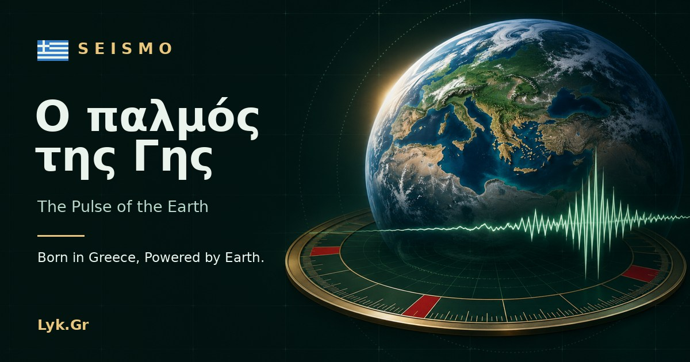
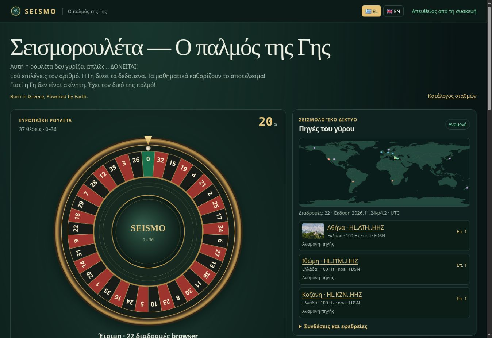

**Ελληνικά** · [English](README.md)

# ΣΕΙΣΜΟΡΟΥΛΕΤΑ — Ο παλμός της Γης!

**Born in Greece, Powered by Earth.**

[Άνοιξε τη Σεισμορουλέτα στα ελληνικά](https://dos.gr/seismo/) · [Open SEISMO in English](https://dos.gr/seismo/en/)

Η Σεισμορουλέτα είναι δωρεάν πείραμα ανοιχτού κώδικα που ενώνει τη σεισμολογία, τα μαθηματικά, την τεχνολογία, την παιδεία και το παιχνίδι. Με το **SPIN**, ο browser δεσμεύει ένα μελλοντικό παράθυρο UTC και ζητά μετρήσεις σε σχεδόν πραγματικό χρόνο από ελληνικά και διεθνή σεισμολογικά δίκτυα. Αν τρεις διαφορετικοί σταθμοί καλύψουν έγκαιρα όλο το παράθυρο, ο αναπαραγώγιμος υπολογισμός δίνει έναν αριθμό από 0 έως 36. Σε άλλη περίπτωση εμφανίζεται **NO RESULT**.

- Κάθε επισκέπτης ξεκινά και ελέγχει τους δικούς του γύρους. Τα παράθυρα μπορεί να επικαλύπτονται και τα αποτελέσματα να συσχετίζονται.
- Η εφαρμογή χρησιμοποιεί HTML5, CSS3 και Vanilla JavaScript. Οι σταθμοί και οι προτεραιότητες βρίσκονται στο [stations.txt](stations.txt).
- Οι δύο γλώσσες χρησιμοποιούν τον ίδιο υπολογισμό. Η εξαγωγή περιλαμβάνει το αποτύπωμα καταλόγου, τα στοιχεία των δειγμάτων και το αποτέλεσμα.
- Οι μάρκες είναι εικονικές. Η εφαρμογή λειτουργεί χωρίς πληρωμές, συνδρομές, χρηματικά στοιχήματα ή έπαθλα.

## Χρήση και επαλήθευση

| Οδηγός | Ελληνικά | English |
|---|---|---|
| Εγκατάσταση και τοπική χρήση | [Εγκατάσταση](docs/INSTALL.el.md) | [Installation](docs/INSTALL.md) |
| Υπολογισμός και επαλήθευση | [Αλγόριθμος](ALGORITHM.md) | [Algorithm](docs/ALGORITHM.md) |
| Σχεδιασμός, δοκιμές και όρια | [Τεχνική έκθεση](docs/PHASE-5.el.md) | [Technical notes](docs/SCIENCE.md) |
| Άδειες δεδομένων και γραφικών | [Απόδοση](NOTICE.md) | [Attribution](docs/NOTICE.en.md) |

**Ιδέα & δημιουργία** — Λυκούργος Κεκεμπάνος | [Lyk.Gr](https://lyk.gr/)  
Με τη συνδρομή της τεχνητής νοημοσύνης GPT.  
Copyleft 2026 — AGPL v3 / CC BY-SA 4.0.

## Η εφαρμογή στον browser

