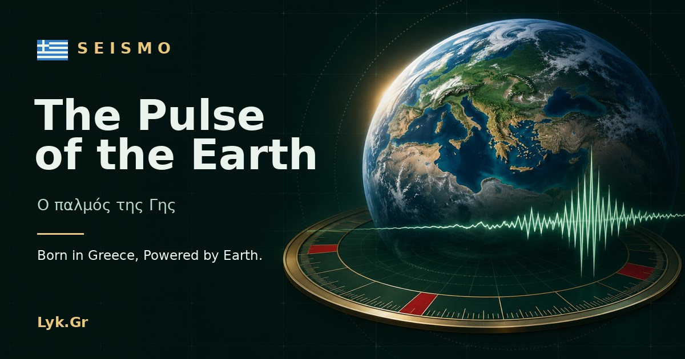
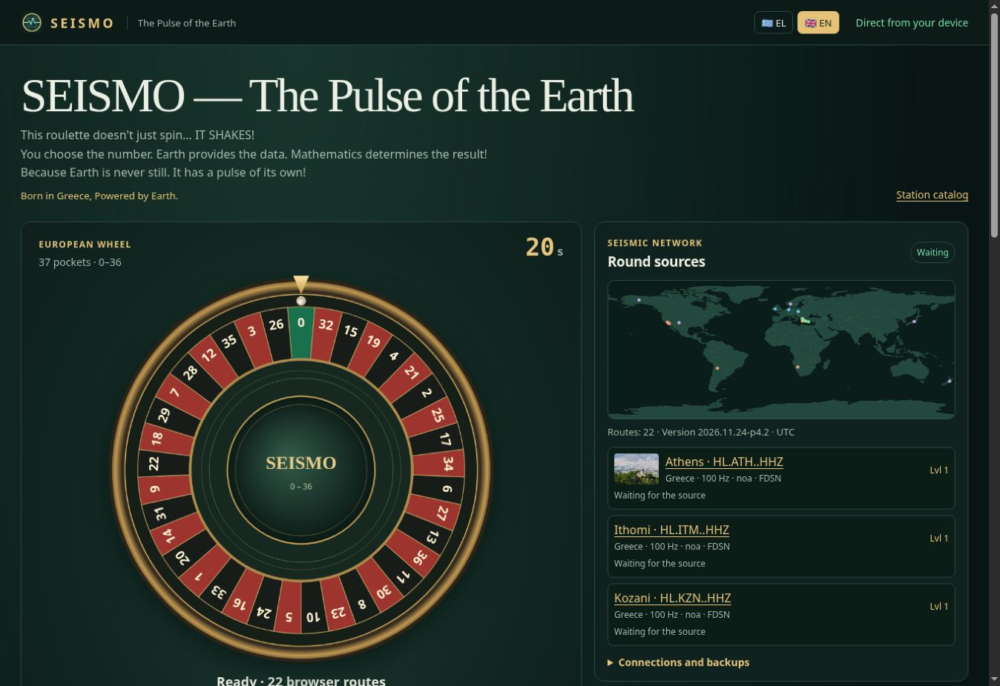

[Ελληνικά](README.el.md) · **English**

# SEISMO — The Pulse of the Earth!

**Born in Greece, Powered by Earth.**

[Open SEISMO in English](https://dos.gr/seismo/en/) · [Άνοιξε τη Σεισμορουλέτα στα ελληνικά](https://dos.gr/seismo/)

SEISMO is a free, open-source experiment that connects seismology, mathematics, technology, education, and play. Press **SPIN** and the browser commits to a future UTC interval. It requests near-real-time measurements from Greek and international seismic networks. If three distinct stations provide complete coverage on time, a reproducible calculation maps their integer samples to a number from 0 to 36. Otherwise the round ends with **NO RESULT**.

- Each visitor starts and verifies their own rounds. Windows may overlap and outcomes need not be statistically independent.
- The browser uses standard HTML5, CSS3 and Vanilla JavaScript. Stations and backup priorities are in [stations.txt](stations.txt).
- Greek and English pages share the same calculation. A round export records the catalog fingerprint, sample evidence, and result.
- Chips are virtual. There are no payments, subscriptions, monetary bets, or prizes.

## Use and verify

| Guide | English | Ελληνικά |
|---|---|---|
| Install or run locally | [Installation](docs/INSTALL.md) | [Εγκατάσταση](docs/INSTALL.el.md) |
| Compute and verify a result | [Algorithm](docs/ALGORITHM.md) | [Αλγόριθμος](ALGORITHM.md) |
| Design, evidence, and scientific limits | [Technical notes](docs/SCIENCE.md) | [Τεχνική έκθεση](docs/PHASE-5.el.md) |
| Third-party data and visuals | [Attribution](docs/NOTICE.en.md) | [Απόδοση](NOTICE.md) |

**Idea & Creation** — Lykourgos Kekempanos | [Lyk.Gr](https://lyk.gr/)  
With the assistance of GPT artificial intelligence.  
Copyleft 2026 — AGPL v3 / CC BY-SA 4.0.

## Browser interface

